# Used Car Price Predictor

**CarValue AI** turns vehicle specifications into an estimated used-car value through a complete Flask and machine learning workflow. A polished, responsive interface, a custom admin workspace, and a reproducible dataset make this an approachable full-stack Python portfolio project.


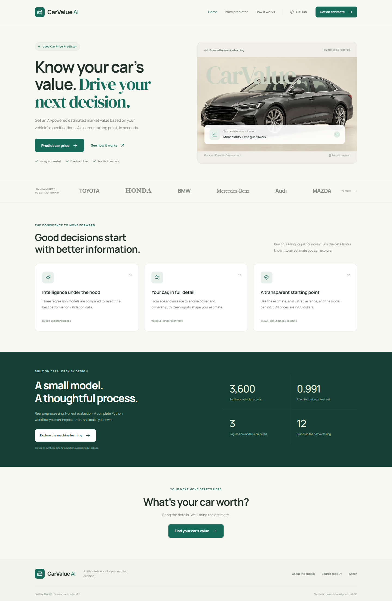

- Estimate a vehicle’s value using 13 features, including automatically calculated age.
- Compare three regression models and serve the saved winning pipeline without retraining at startup.
- Explore protected dashboards, search prediction history, and inspect dataset quality.
- Run locally with bundled data, model, fonts, Bootstrap, and charts. No external service keys required.

**All prices are in US dollars (USD). This is an educational demo trained on synthetic data, not live vehicle listings.**

## Project Overview

The public site provides a landing page, guided vehicle form, private session-bound result view, and an explanation of the ML workflow. Every successful prediction is saved in SQLite. Administrators can inspect usage and model performance through a separate, session-protected workspace.

### Why This Project?

This project demonstrates full-stack Python development with Flask, data preprocessing, regression modeling, database integration, authentication, admin dashboards, and responsive frontend development. The complete training-to-inference workflow is readable and reproducible.

## Features

| Public experience | Admin workspace | Engineering |
| --- | --- | --- |
| Dependent brand/model/fuel dropdowns | Total and daily prediction counts | Flask app factory and blueprints |
| Reference specs with editable trim details | Average value and top brand | SQLAlchemy models with SQLite |
| Automatic age and live vehicle preview | Chart.js activity and brand charts | Hashed passwords and CSRF protection |
| Server and browser input validation | Search, sort, and pagination | Saved preprocessing/regression pipeline |
| Loading state and reset controls | Delete one or clear with typed confirmation | Reproducible generation and model selection |
| Estimate, illustrative range, and input details | Dataset health and numeric statistics | Automated tests and GitHub Actions |
| Custom error pages and mobile navigation | Labeled, idempotently seeded demo history | Vendored assets and reduced-motion support |

## Demo / Screenshots

These are actual screenshots of the running application, captured with the included Playwright script. The decorative hero car is an AI-generated asset; it is not a real vehicle listing.

<details>
<summary>Public prediction experience</summary>

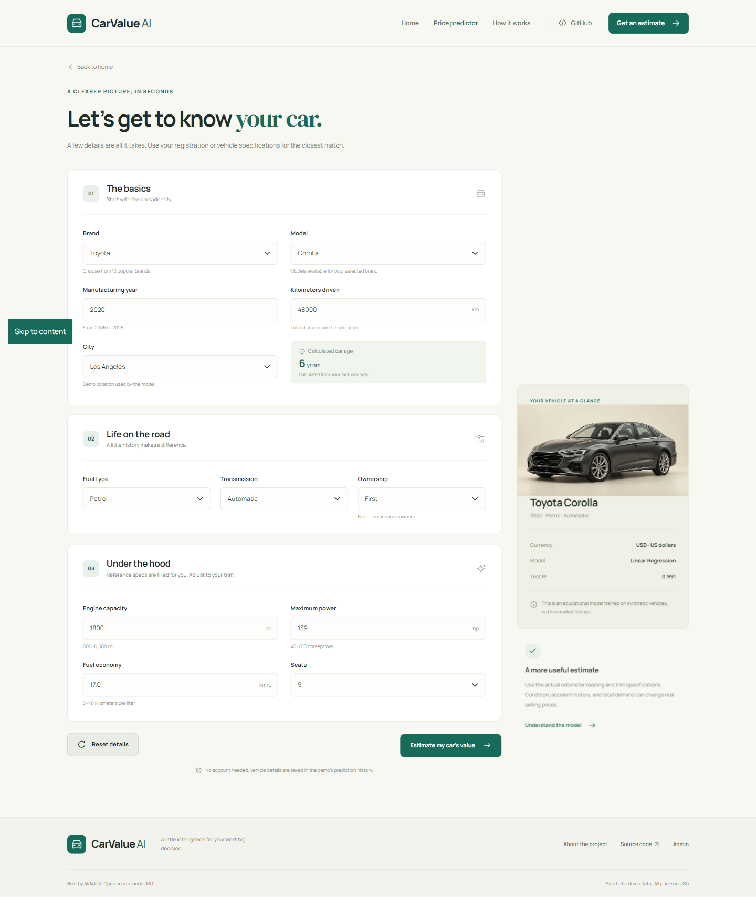
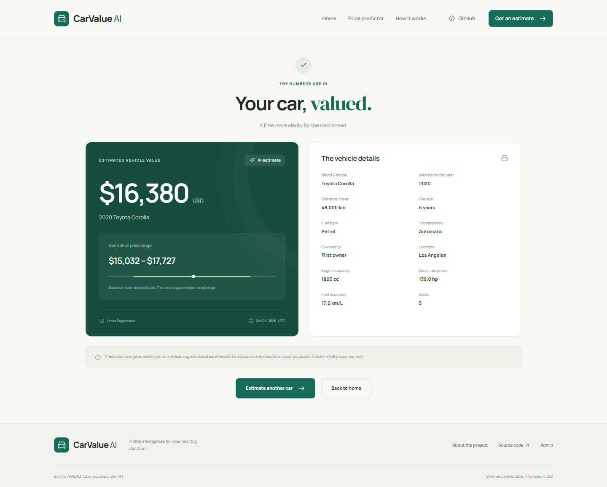

</details>

<details>
<summary>Admin workspace</summary>

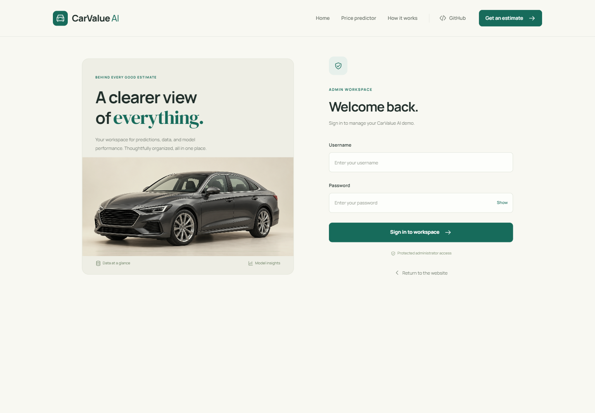
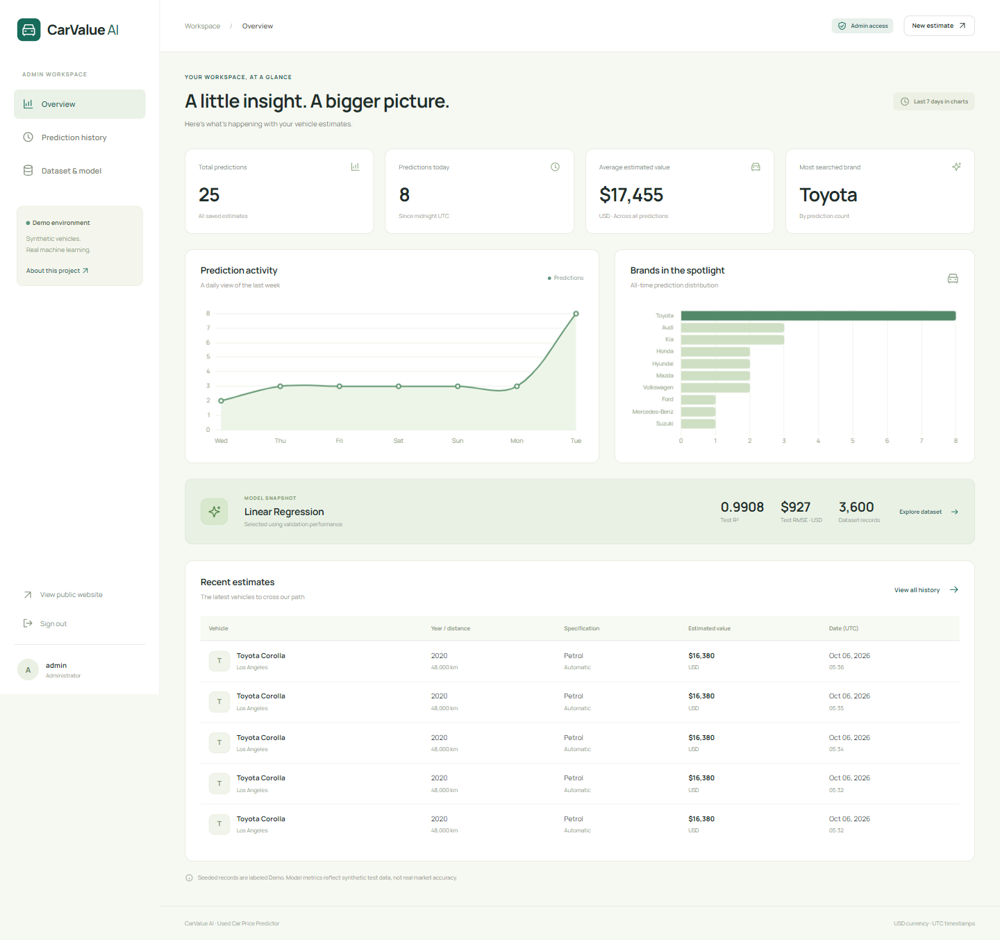
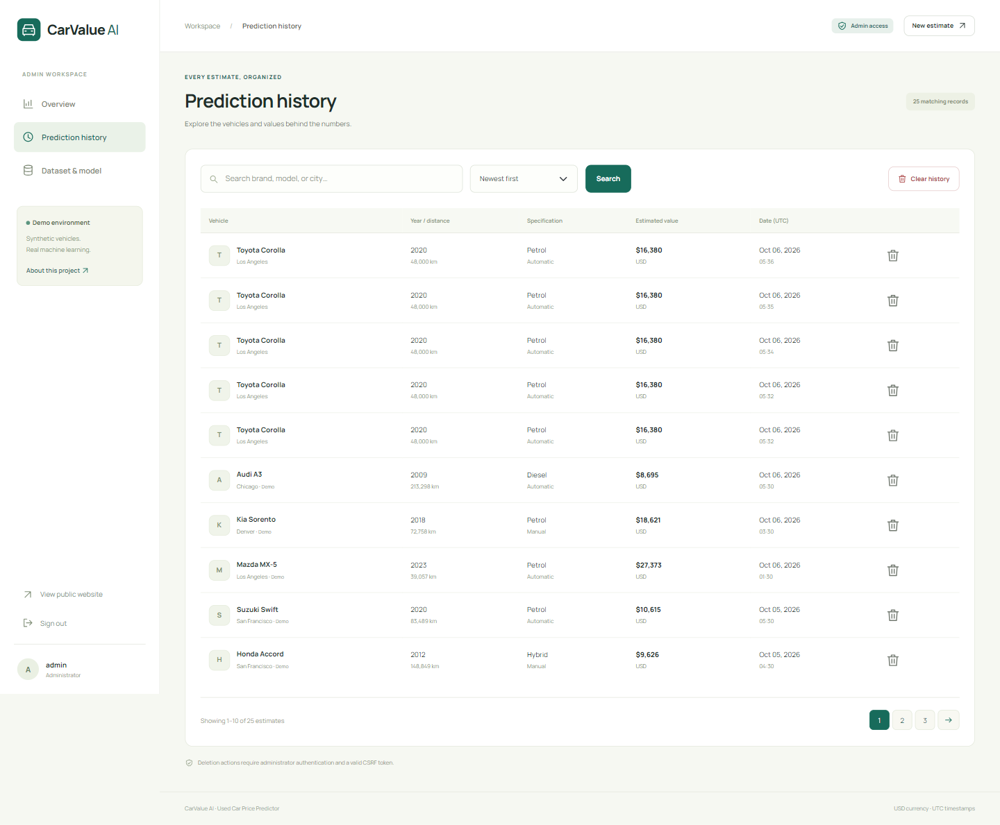
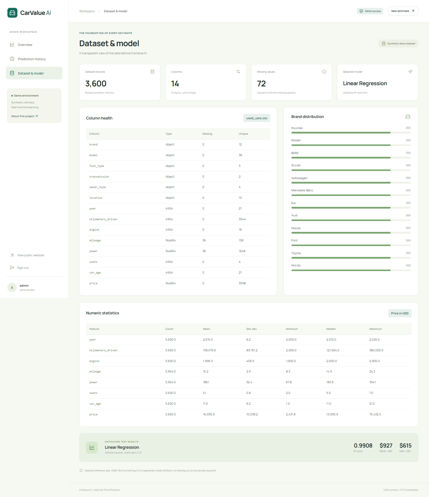

</details>

<details>
<summary>About the model and mobile layouts</summary>

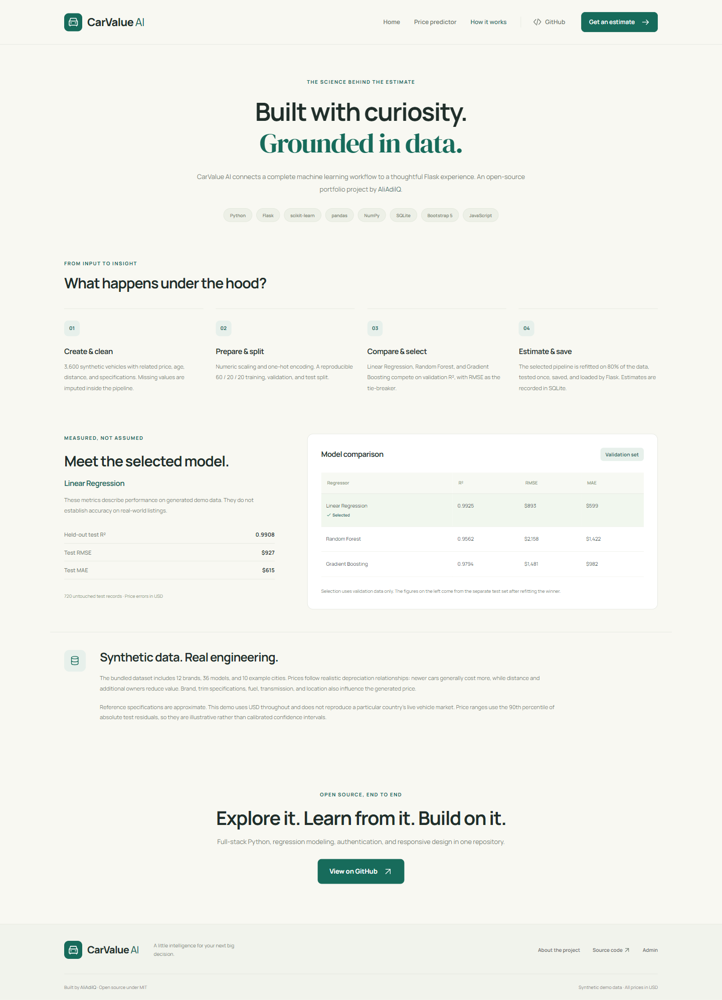
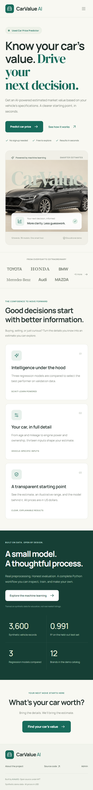
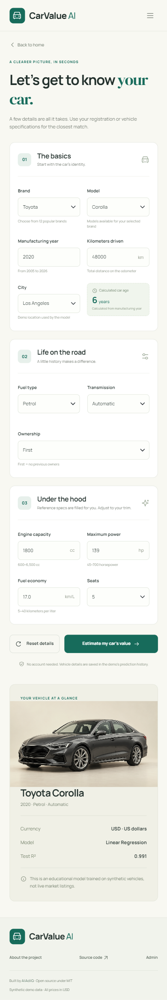
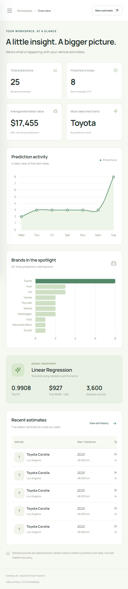

</details>

To regenerate screenshots, start and seed the local app, install [Node.js](https://nodejs.org/), and run in another terminal:

```bash
npm ci
npx playwright install chromium
npm run screenshots
```

Optional environment variables: `BASE_URL`, `BROWSER_PATH`, `ADMIN_USERNAME`, and `ADMIN_PASSWORD`. The script creates one real prediction, logs in, checks dependent dropdowns and reset behavior, verifies charts and search, checks mobile overflow/navigation, and saves `docs/screenshots/verification.json`. Use a local demo database for this script.

## Machine Learning Model

`train_model.py` compares **Linear Regression**, **Random Forest Regressor**, and **Gradient Boosting Regressor**.

1. Load and clean the CSV; remove duplicates and invalid targets.
2. Split data reproducibly into 60% training, 20% validation, and 20% test records.
3. Impute numeric values with training medians and categorical values with training modes.
4. Scale numeric features and one-hot encode categorical features inside a `ColumnTransformer`.
5. Train each regressor with a log-transformed price target to model proportional differences and produce positive estimates.
6. Choose the highest validation R², breaking ties with the lowest validation RMSE.
7. Refit the winning pipeline on the 80% development set and evaluate on the untouched 20% test set.
8. Save the pipeline and metadata, including metrics, feature bounds, dataset fingerprint, and library version.

The bundled winner is **Linear Regression**. More complex models are not automatically better: the synthetic generator’s smooth depreciation relationships suit the linear model with a log target.

Artifacts:

- `models/car_price_model.pkl`: compressed joblib-serialized sklearn pipeline, including preprocessing.
- `models/model_metrics.json`: validation comparison, final test metrics, splits, and provenance.

Only load trusted model artifacts. The app does not train at server startup or during requests.

## Dataset

`data/used_cars.csv` contains **3,600 synthetic records**, **12 brands**, **36 models**, and **10 demo cities**. The generator uses a fixed seed of 42 and a reference year of 2026. Vehicle years range from 2005 to 2025. The form additionally permits the current year, which is outside this bundled dataset’s year range.

Brands: Toyota, Honda, Hyundai, Suzuki, Kia, Nissan, Ford, BMW, Mercedes-Benz, Audi, Volkswagen, and Mazda.

Prices follow related depreciation factors: age and distance reduce value; premium vehicles and stronger configurations generally cost more; fuel, transmission, owners, and location also affect value. Small price noise represents unobserved variation. About 1% of fuel-economy and power entries are intentionally missing so imputation is exercised. Reference configurations are illustrative, not authoritative manufacturer specifications.

| Input | Unit / meaning |
| --- | --- |
| Brand, model | Catalog categories |
| Year, car age | Manufacturing year; age derived from the current UTC year |
| Kilometers driven | km, not miles |
| Fuel type | Petrol, Diesel, or Hybrid where available |
| Transmission | Automatic or Manual |
| Owner type | First, Second, Third, or Fourth or more; First means no previous owners |
| Engine | Cubic centimeters (cc) |
| Mileage / fuel economy | Kilometers per liter (km/L), distinct from distance driven |
| Maximum power | Horsepower (hp) |
| Seats | Number of seats |
| Location | One of ten example cities |
| Price target | USD |

The model does not account for vehicle condition, accidents, service history, live demand, inflation, or actual listing prices. New data and retraining are needed for a real market application. Update the generator’s reference year when refreshing the dataset in later years.

## Model Performance

The bundled artifacts report the following **validation** results on 720 records:

| Regressor | R² | RMSE (USD) | MAE (USD) |
| --- | ---: | ---: | ---: |
| **Linear Regression — selected** | **0.992503** | **$892.67** | **$598.74** |
| Random Forest | 0.956199 | $2,157.76 | $1,422.49 |
| Gradient Boosting | 0.979372 | $1,480.79 | $981.90 |

After refitting on 2,880 records, the selected model’s **untouched test** results on 720 records are:

| R² | RMSE (USD) | MAE (USD) |
| ---: | ---: | ---: |
| **0.990845** | **$926.75** | **$614.56** |

The result range is the estimate ± the 90th percentile absolute test residual, clipped at zero. It is illustrative, **not a calibrated confidence interval**. Strong synthetic-data metrics do not establish real-world market accuracy. The JSON file is the source of truth after any retraining.

## Tech Stack

| Layer | Technologies |
| --- | --- |
| Application | Python 3.12, Flask, Jinja2, Flask-WTF, WTForms |
| Data and ML | pandas, NumPy, scikit-learn, joblib |
| Persistence and authentication | SQLite, Flask-SQLAlchemy, Werkzeug password hashing, signed sessions |
| Frontend | HTML5, CSS3, Bootstrap 5.3.8, JavaScript, Chart.js 4.5.1 |
| Tooling | pytest, GitHub Actions, optional Playwright screenshot checks |
| WSGI serving | Waitress, compatible with Windows and Unix |

Fonts and browser libraries are served locally. Their upstream licenses are bundled in `static/fonts/` and `static/vendor/`. See the [Flask documentation](https://flask.palletsprojects.com/), [scikit-learn documentation](https://scikit-learn.org/1.7/), and [Bootstrap documentation](https://getbootstrap.com/docs/5.3/) for the underlying libraries.

## Project Structure

```text
used_car_price_predictor/
├── app.py                    # Application factory and local server
├── config.py                 # Environment and path configuration
├── extensions.py             # SQLAlchemy and CSRF extensions
├── database.py               # Admin and Prediction tables
├── forms.py                  # Server-side validation
├── generate_dataset.py       # Reproducible synthetic generator
├── train_model.py            # Compare, evaluate, and save models
├── seed.py                   # Idempotent demo initialization
├── wsgi.py                   # Waitress application entry point
├── requirements.txt          # Pinned direct Python dependencies
├── requirements.lock.txt     # Complete tested environment snapshot
├── .env.example
├── .gitignore
├── LICENSE
├── README.md
├── data/used_cars.csv
├── models/
│   ├── car_price_model.pkl
│   └── model_metrics.json
├── instance/.gitkeep         # Runtime DB/key created locally and ignored
├── routes/                   # Public and admin blueprints
├── services/                 # Vehicle catalog and inference service
├── templates/                # Public, admin, and error templates
├── static/                   # CSS, JS, images, fonts, vendored libraries
├── scripts/capture_screenshots.cjs
├── docs/screenshots/         # Real application screenshots
├── tests/                    # Isolated SQLite tests, with CSRF enabled
├── package.json              # Optional screenshot tooling only
├── package-lock.json
└── .github/workflows/tests.yml
```

## Installation

Use **Python 3.12** (tested); Python 3.8 is not supported by these dependencies. Node.js is only needed to regenerate screenshots.

```bash
git clone https://github.com/AliAdilQ/used_car_price_predictor.git
cd used_car_price_predictor
python -m venv venv
```

Windows PowerShell:

```powershell
venv\Scripts\Activate.ps1
```

Windows Command Prompt:

```bat
venv\Scripts\activate
```

macOS / Linux:

```bash
source venv/bin/activate
```

Install the project dependencies:

```bash
pip install -r requirements.txt
```

For the complete tested Python 3.12 dependency snapshot, use `pip install -r requirements.lock.txt` instead. If PowerShell activation is restricted, run commands with `venv\Scripts\python.exe` directly; no system policy change is necessary.

## Setup

Copy the environment example:

```powershell
# Windows PowerShell
Copy-Item .env.example .env
```

```bash
# macOS / Linux
cp .env.example .env
```

Generate a random key and set the printed value as `SECRET_KEY` in `.env`:

```bash
python -c "import secrets; print(secrets.token_hex(32))"
```

Keep `APP_ENV=development` and `FLASK_DEBUG=0` for the local demo. Without a configured development key, the app generates a persistent local key in ignored `instance/.secret_key`. Production startup refuses a missing or placeholder key. Never commit `.env` or the runtime database/key.

The dataset and model are already bundled. Training is optional for initial use. Initialize the demo database, then start Flask:

```bash
python seed.py
python app.py
```

## How to Train the Model

```bash
python train_model.py
```

This uses the existing CSV, prints all three validation scores, and overwrites both model artifacts with the newly selected pipeline and metadata. If the CSV is missing, it generates the default dataset first.

To deliberately regenerate the synthetic CSV before retraining:

```bash
python generate_dataset.py --rows 3600
python train_model.py
```

Use the pinned scikit-learn version when loading the bundled artifact. If you change libraries or data, retrain and restart the web server. Model metadata and README performance numbers should be refreshed when the model changes.

## How to Seed the Database

```bash
python seed.py
```

The command creates tables, hashes the demo administrator’s password, and adds 20 realistic demo predictions. Unique seed keys prevent duplicates on repeated runs. Existing passwords and records are preserved. Deleted demo records are restored by a later seed run; do not seed a database if you intend its cleared history to remain empty.

To choose credentials, set `ADMIN_USERNAME` and `ADMIN_PASSWORD` in `.env` before the first seed. To intentionally rotate an existing account’s password:

```bash
python seed.py --reset-admin
```

The runtime database is `instance/app.db`. It is recreated locally rather than committed with passwords and user history.

## How to Run the Application

```bash
python app.py
```

- Website: [http://127.0.0.1:5000](http://127.0.0.1:5000)
- Predictor: [http://127.0.0.1:5000/predict](http://127.0.0.1:5000/predict)
- About: [http://127.0.0.1:5000/about](http://127.0.0.1:5000/about)
- Admin login: [http://127.0.0.1:5000/admin/login](http://127.0.0.1:5000/admin/login)

`HOST` and `PORT` can be configured in `.env`. Public result URLs are `/result/<uuid>` and require the originating browser session or an authenticated administrator.

For serving beyond local development, configure a unique key and administrator credentials, set `APP_ENV=production`, use HTTPS through a reverse proxy, and run:

```bash
waitress-serve --listen=127.0.0.1:8000 wsgi:application
```

Production cookies require HTTPS. The application has hashed passwords, signed sessions, POST-only logout/deletion, CSRF-protected mutations, input validation, security headers, and process-local login throttling (five attempts per five minutes). A production service should add a shared-store rate limiter, backups, database migrations, and an appropriate real dataset. Keep debug mode off.

## Admin Panel

| Route | Purpose |
| --- | --- |
| `/admin/login` | Administrator sign-in |
| `/admin/` | Summary cards, activity/brand charts, model metrics, recent estimates |
| `/admin/predictions` | Search by brand/model/city; sort by date/price; 10 records per page |
| `/admin/dataset` | Row/column counts, missing values, numeric statistics, brand distribution, model metrics |
| `/admin/logout` | POST-only sign-out |
| `/admin/predictions/<id>/delete` | POST-only deletion with UI confirmation |
| `/admin/predictions/clear` | POST-only clear requiring typed `CLEAR` |

All administrative pages except login require a valid account session. Dashboard dates and stored timestamps use UTC. Seeded records carry a Demo label.

## Demo Admin Credentials

### Demo Admin Login

Username: `admin`

Password: `Admin@123`

**Development/Demo credentials only. Change these credentials before production deployment.**

> These credentials are provided only for local development and demonstration. Change them before deploying the application publicly.

The plaintext default appears only in the demo seed/tooling/documentation; the database stores a Werkzeug password hash. Production seeding rejects the demo password and requires a custom password of at least 12 characters.

## Running Tests

```bash
pytest
```

Tests use isolated in-memory SQLite databases and leave the demo database untouched. Coverage includes public routes, end-to-end prediction storage, session-bound results, invalid categories/ranges/non-finite values, CSRF, admin login/logout, throttling, protected pages, password hashing, idempotent seeding, search/sort/pagination, deletion confirmation, local assets, model selection, and README image paths.

Browser checks are optional and run with `npm run screenshots` as described above. They use a real Chromium browser and verify both desktop and 390 px mobile layouts. GitHub Actions runs pytest on Python 3.12 for pushes and pull requests.

## Future Improvements

- Train and validate on licensed, representative market listings.
- Add condition, accident history, service history, and market freshness features.
- Evaluate calibrated prediction intervals and subgroup errors.
- Add migrations, persistent rate limiting, audit events, and deployment tooling.
- Extend currencies and catalogs with region-specific data.

## Contributing

Fork the repository, make a focused change, and open a pull request explaining the behavior and validation. Run `pytest` before submitting; regenerate screenshots when changing the UI. Keep real secrets, personal history, and external datasets out of commits unless their licensing and privacy requirements are addressed.

## License

Licensed under the [MIT License](LICENSE). Bundled third-party libraries/fonts retain their accompanying licenses.

## Author

**AliAdilQ**

- GitHub: [github.com/AliAdilQ](https://github.com/AliAdilQ)
- Repository: [AliAdilQ/used_car_price_predictor](https://github.com/AliAdilQ/used_car_price_predictor)
